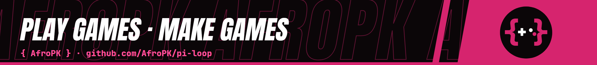

<p align="center">
  
</p>

<p align="center">
  
  
  
  
</p>

<p></p>

**`{ pi-loop }`**: a plan → review → exec → code-review loop that runs entirely on local inference, on one 12 GB GPU.

No cloud API, no keys. A 27B thinking model writes a verified plan, a fresh session of the same model reviews it, and a 9B coder executes it slice by slice. Both models fit fully in VRAM and llama-swap swaps between them on demand.

> [!NOTE]
> Needs a llama.cpp `llama-server` build for your GPU, llama-swap, and both GGUFs. Tested on an AMD RX 6750 XT 12 GB on ROCm; NVIDIA 12 GB should work with a CUDA build but is untested here.

<p></p>

```
 pi-pe "task"
   │
   ├─ pi-plan    Swift 1.5 27B (IQ2_XS + MTP, 48K ctx)  thinking medium  → PLAN.md, PLAN.files/, PLAN.notes.md
   ├─ pi-review  Swift 1.5 27B, fresh session            thinking medium  → appends ### REVIEW CORRECTIONS
   ├─ pi-exec    Ornith 1.5 9B (Q8_0 + MTP, 80K ctx)     thinking low     → edits code, ticks boxes, runs Verify
   └─ pi-code-review  Swift 27B, fresh session          thinking medium  → PLAN.review.md; proven bugs become
                                                                           a fix slice at the top of PLAN.next.md
                 ▲ llama-swap swaps models (~30–40 s) — only one fits in 12 GB at a time
```

Both GGUFs carry their own multi-token prediction head, so `draft-mtp` speeds up decoding with no separate draft model: 27B ~41 tok/s, 9B ~62 tok/s. The prompts force small slices, code written once into `PLAN.files/`, a rehearsal in a scratch copy and a mandatory self-test, so "done" means proven. `pi-code-review` only reviews what `pi-exec` changed, and every finding needs a proof script and its real output — at most 3 correctness findings, no style.

<p></p>

**Needs:** Node.js 22+ · Git for Windows · a GPU llama.cpp build · llama-swap · both GGUFs

```bash
npm i -g @earendil-works/pi-coding-agent
# llama-swap: unzip to C:\llama-swap
```

1. Download the models: planner/reviewer `ukisai/Swift-1.5-Qwen3.8-27B-GSQ-RCO-GGUF` (`...-IQ2_XS-mtp.gguf`, 8.8 GB) and executor `ornith-ai/Ornith-1.5-9B-GGUF` (`Ornith-1.5-9B-Q8_0.gguf`, 9.8 GB).
2. Copy `llama-swap/config.yaml` and `start-llama-swap.bat` to `C:\llama-swap`, set the `server` and `models` macros to your paths.
3. Merge `pi-config/models.json` into `%USERPROFILE%\.pi\agent\models.json` and the relevant keys of `settings.example.json` into `settings.json`. Set `"shellPath"` to Git's `bash.exe`. `pi --list-models` must show `swift27-xs-64k` and `ornith9b-q8`.
4. Copy `launchers/` and `prompts/` into one folder on your PATH, rename `environment.example.md` to `environment.md` and edit it for your PC.
5. Recommended: install `pi-loop-police@1.14.1` and apply `patches/pi-loop-police-1.14.1-recovery.patch`.
6. In a project folder: `pi-pe "Add a --json flag to report.py that prints the summary as JSON, with a unittest"`.

Or run the steps yourself so you can read the plan first: `pi-plan "task"` → `pi-review` → `pi-exec` → `pi-code-review` → `pi-stop`.

<p></p>

| Needed for | Linux | Windows 10/11 |
|---|---|---|
| Pi | Node.js 22+, `pi` on PATH | the same (`pi` lands in `%APPDATA%\npm`) |
| Models | GPU `llama-server` build, llama-swap, both GGUFs | the same; llama-swap in `C:\llama-swap` |
| Shell for agents | bash 4+ with coreutils and `curl` | Git for Windows (Git Bash), set Pi's `shellPath` |
| Feed and checks | Python 3 (stdlib) as `python3` | Python 3 as `python`; `windows\bin\python3` maps it |
| `--tui` (optional) | built-in `curses` | `pip install windows-curses` |
| `--tmux` (optional) | `tmux` | not available |
| Web search (optional) | Firecrawl MCP + `pi-mcp-adapter` | the same |

On Linux, Swift fits 64K and Ornith Q6_K runs 160K (77 tok/s short, 735 tok/s prefill). `linux/` has the bash launchers and a systemd user unit.

<p></p>

| Path | What |
|---|---|
| `linux/` | bash launchers, `pi-feed.py`, Linux environment example, llama-swap config + systemd unit |
| `windows/` | `pi-loop.cmd` (runs the bash scripts under Git Bash), `bin/` shims, Windows TUI |
| `launchers/` | Windows `pi-plan`, `pi-review`, `pi-exec`, `pi-pe`, `pi-stop`, `ensure-server.ps1` |
| `prompts/` | planner, reviewer, executor and code-reviewer role rules, plus `environment.example.md` |
| `llama-swap/` | `config.yaml` with both models' tuned flags |
| `pi-config/` | Pi provider/model definitions and compaction settings |
| `patches/` | fix for pi-loop-police's loop recovery silently ending the session |
| `docs/` | [WORKFLOW](docs/WORKFLOW.md) · [MODELS](docs/MODELS.md) · [TUNING](docs/TUNING.md) · [HARDWARE](docs/HARDWARE.md) · [TROUBLESHOOTING](docs/TROUBLESHOOTING.md) |

<p></p>

- llama-swap holds one model at a time for everyone using it — don't run two jobs at once.
- Model IDs live in three places and must match: the launchers, llama-swap's `config.yaml`, and Pi's `models.json`.
- A plain `pi-loop` resumes wherever the files on disk say, after a stop or Ctrl-C. `--tmux` doesn't work on Windows.
- First run on a two-slice todo CLI: 8/8 tests, every command and error path correct. The first code review found a real pass-counter bug and missed a ko-rule bug, with no false findings.
- MIT for the scripts and prompts. The models have their own licences.

<p align="center">
  
</p>
